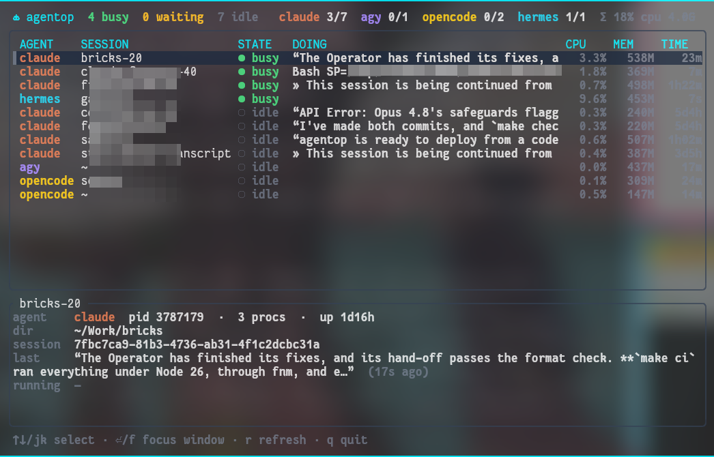
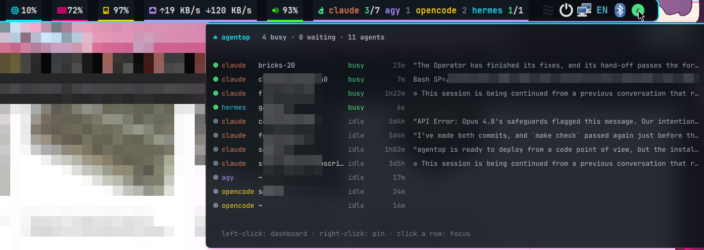

# agentop

**See what your AI coding agents are doing.** A tray icon, a status-bar block and a terminal
dashboard for **Claude Code, Codex, Gemini CLI, Antigravity (agy), opencode and Hermes**, all in
one static Rust binary (~3 MB). There's no daemon, the tray uses about 10 MB of RAM, and it works
on X11 and Wayland.



- **Tray icon**: a badge with the number of busy agents (green), agents waiting for you (amber),
  or a grey ring when everything is idle. Hover or open the menu for the per-agent list, click to
  open the dashboard, and click an agent to jump to its terminal.
- **Dashboard** (`agentop`): every agent with its session, state, current action, CPU, RAM and
  busy time, plus a top-style process list where each agent's processes are tagged. Three tabs:
  **Overview** (agents above processes), **Agents** (with a detail pane) and **Processes**
  (full view).
- **Notifications** when an agent finishes a long task or needs your input.
- **Optional bar blocks** for polybar and i3bar.

## Install

```sh
curl -fsSL https://raw.githubusercontent.com/sacx/agentop/main/install.sh | sh
```

This installs `~/.local/bin/agentop`, a launcher entry, and tray autostart (XDG autostart:
GNOME, KDE, XFCE, Cinnamon, MATE, LXQt…), then starts the tray. Add options with `sh -s --`:

```sh
curl -fsSL https://raw.githubusercontent.com/sacx/agentop/main/install.sh | sh -s -- --i3 --polybar
```

| option | effect |
|---|---|
| `--i3` | autostart the tray from i3, float the dashboard window, and add the block to i3bar (`status_command … \| agentop i3bar`) |
| `--polybar` | add a `[module/agentop]` block and put it before `tray` in `modules-right` |
| `--from-source` | build with cargo instead of downloading a release binary |
| `--no-start` | don't start the tray now |
| `--uninstall` | remove the binary, desktop files and every config change |

i3 with polybar (`--i3 --polybar`): the bar block next to the tray icon, with the tray popup open.



Config edits sit between `# >>> agentop >>>` markers, so re-running the installer is safe. Each
edited file gets a `*.agentop-bak` backup. From a checkout, run `./install.sh` (it builds
locally) or `cargo install --path .`. Env overrides: `AGENTOP_BIN_DIR`, `AGENTOP_VERSION`
(tag), `AGENTOP_REPO`.

## Use

| command | |
|---|---|
| `agentop` | dashboard, opens on the Overview tab (`--view agents\|procs` to start elsewhere) |
| `agentop top` | dashboard opened on the full process list |
| `agentop open` | toggle the dashboard in a floating terminal window (class `agentop`) |
| `agentop tray` | tray icon (started automatically after install) |
| `agentop status [--json]` | one-shot list, e.g. for scripts |
| `agentop polybar` / `agentop i3bar` | bar outputs (`--short`, `--detail`, `--no-icons`, `--interval N`) |

Dashboard keys:

| key | |
|---|---|
| `1` `2` `3` / `Tab` | Overview · Agents · Processes |
| `↑↓` `jk` `PgUp/PgDn` `g/G` | select; `←→` switches pane on Overview |
| `⏎` / `f` | focus the terminal window of the selected agent or process |
| `c` `m` `t` `p` `n` | sort processes by CPU, memory, CPU time, pid, name (again to reverse) |
| `a` | only processes that belong to an agent |
| `/` | filter by pid, user, command or agent name (`Esc` clears) |
| `K` | send SIGTERM to the selected process (asks first) |
| `r` / `q` | refresh / quit |

On Overview, selecting an agent highlights its processes in the list below.

Tray click actions:

| backend | left-click | right-click / menu | hover |
|---|---|---|---|
| **StatusNotifierItem** (KDE, GNOME with the AppIndicator extension, XFCE, Cinnamon, waybar, …) | dashboard | agent list, then click to focus | tooltip summary |
| **XEmbed** (polybar, i3bar, stalonetray, trayer) | dashboard | pin the popup, then click a row to focus | popup summary |

The tray picks the backend automatically; override with `agentop tray --backend sni|xembed`.
Only one tray instance runs at a time. Turn off notifications with `--no-notify`: edit `Exec=` in
`~/.config/autostart/agentop-tray.desktop`, or the `exec` line in your i3 config if you used `--i3`.

Sway/other WMs: add `exec agentop tray` to your config. On sway the floating rule is
`for_window [app_id="agentop"] floating enable`.

## How detection works

agentop scans `/proc` every 1–2 s. It matches agent processes by executable name and sums CPU and
RAM over each agent's process tree. Shell commands an agent runs (tool calls) appear as *running*.

| agent | state source |
|---|---|
| Claude Code | **exact**: `~/.claude/sessions/<pid>.json` (busy/idle, session name), plus the last tool call or message from the session transcript |
| codex, gemini, agy, opencode, hermes | **heuristic**: busy while smoothed CPU ≥ 5 % or a tool command is running |

MCP servers and other helper processes don't count as work.

## Configuration (env)

| variable | default |
|---|---|
| `AGENTOP_TERM` | first found of kitty, alacritty, wezterm, ghostty, foot, gnome-terminal, konsole, xfce4-terminal, tilix, xterm; e.g. `"alacritty --class agentop -e"` |
| `AGENTOP_FONT` | font file for the tray badge/popup (default: fontconfig monospace) |
| `AGENTOP_TRAY_BG` | XEmbed icon background on trays without transparency, e.g. `#0A0E14` |

Optional runtime tools: `notify-send` (notifications), `fc-match` (fonts), and `i3-msg` or an
EWMH window manager (focus). The `󰚩` glyph in the bar blocks needs a Nerd Font; use `--no-icons`
otherwise.

## Development

```sh
cargo run -- status          # quick check
cargo build --release        # target/release/agentop
git tag v0.1.0 && git push --tags   # CI builds static x86_64 + aarch64 binaries into the release
```

`src/scan.rs` handles detection, `src/claude.rs` reads Claude session state, `src/sni.rs` and
`src/xembed.rs` are the tray backends, `src/tui.rs` is the dashboard and `src/bar.rs` has the
bar outputs. To add exact state for another agent, follow `claude::session`.

MIT licensed.
